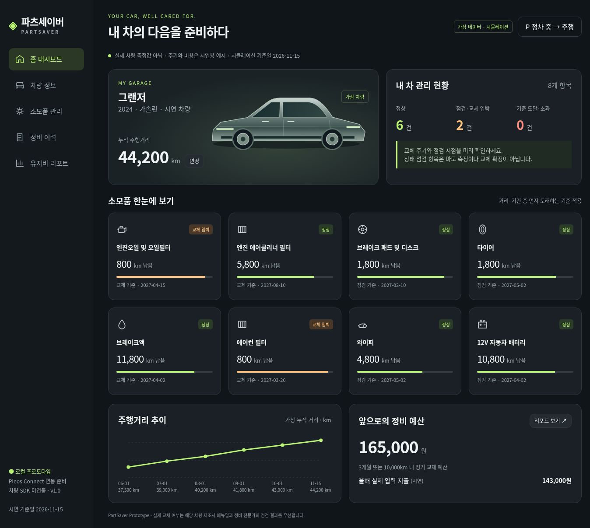

# 파츠세이버 · PartSaver

내 차의 소모품 교체 시기부터 유지비까지 한눈에 관리하는 **작동 가능한 웹 시제품**입니다.

> 모든 기본 차량·주행거리·정비 이력·주기·비용은 가상 시연 데이터입니다. 실제 차량 신호나 제조사 공식 정비 기준이 아닙니다. Pleos SDK 미연동 / APK 미빌드 / Android 실행 미검증.



## 바로 실행

설치 없이 `dist/PartSaver.html`을 데스크톱 Chrome/Edge 등에서 여세요. CSS·JS를 포함하는 단일 HTML입니다. 파일 URL의 저장 허용 여부는 브라우저 정책에 따라 다릅니다. 안정적인 저장을 확인한 방식은 HTTP 접속입니다.

권장 로컬 실행 (Python 3 필요):

```sh
python3 -m http.server 8080 --directory dist
```

브라우저에서 http://localhost:8080 을 엽니다. npm 설치나 빌드가 필요하지 않습니다. 인터넷 연결 없이 계산·조회·입력이 가능합니다. 데이터는 현재 브라우저의 localStorage에만 보관되며 다른 기기나 URL과 공유하지 않습니다.

## 구현 기능

- 홈 / 차량 정보 / 소모품 관리 / 정비 이력 / 유지비 리포트 5개 화면
- 모델·연식·동력 방식·누적 거리·알림 임계값·기준일 수정 및 저장
- 내연기관 8종, 전기차 6종 관리 (엔진오일·흡기 필터 제외)
- 거리·개월 중 먼저 도래하는 기준에 따른 정상·임박·기준 도달/초과 표시
- 항목별 거리·기간 주기와 예시 견적 사용자 수정; 0은 해당 기준 미적용
- 교체·점검 이력 추가/수정, 날짜·거리·실제 비용·업체·메모 입력
- 정기 교체 항목의 단순 점검은 교체 기준을 초기화하지 않음
- 최신 유효 정비 기록으로 다음 관리 시점 갱신
- 3개월 또는 10,000km 이내의 정기 교체 예상 예산; 상태 점검 항목의 조건부 교체비 별도 표시
- 월별/연도별 실제 지출, 완료 정비의 기록 당시 견적과 실제 지출 비교
- 가상 주행거리 추이 그래프와 월별 지출 막대그래프
- 새로고침 후 저장 유지; JSON 백업 내보내기
- 시연용 주행 모드에서 메뉴·상세·입력 제한

## 시연 순서 (약 48초)

1. 초기 상태: 44,200 km, 엔진오일과 에어컨 필터 800 km 남음.
2. 홈의 `변경`에서 45,200 km 입력: 두 항목 200 km 초과, 타이어·브레이크는 점검 임박.
3. 엔진오일 상세 → 정비 기록 입력.
4. 2026-11-15 / 45,200 km / 교체 / 105,000원 저장.
5. 엔진오일 다음 기준 55,200 km / 2027-11-15, 남은 거리 10,000 km.
6. 정비 이력과 리포트 확인: 연간 지출 143,000원 → 248,000원.

영상: `demo/PartSaver_Demo.mp4` (1920×1080, H.264, 30fps 출력, 48.1초, 무음·한국어 자막). 실제 앱 조작 중 브라우저 화면을 약 5fps로 연속 캡처해 시간 간격을 유지하여 MP4로 인코딩했습니다. 30fps는 출력 프레임률이며 원본 화면 캡처율과 다릅니다. 합성 UI나 앱 동작을 연출한 목업 영상이 아닙니다.

초기화: 차량 정보 → 시연 데이터 초기화 → 확인. 초기 기준일은 2026-11-15로 고정되며, 차량 정보에서 한국시간 오늘 날짜로 전환할 수 있습니다.

## 기술과 폴더 구조

| 경로 | 역할 |
|---|---|
| `dist/index.html`, `style.css`, `app.js` | 한국어 화면·입력·SVG 도형/그래프 |
| `dist/engine.js` | 순수 함수 중심 거리/기간/정비/비용 계산 |
| `dist/provider.js` | localStorage 저장·가상 신호 출처 경계 |
| `dist/PartSaver.html` | 단일 파일 배포본 |
| `tests/engine.test.cjs` | Node 내장 테스트 러너, 12개 회귀 테스트 |
| `scripts/build-standalone.py` | 단일 HTML 재생성 |
| `android/` | Kotlin WebView 호스트 소스, 미빌드·미검증 |
| `apk/NOT_BUILT.md` | APK 미제공 상태 명시 |
| `docs/` | 공식 안내 대조, 제출 요약, 테스트 기록, 스크린샷 |
| `demo/` | 실제 조작 MP4, 자막, 시연 대본 |

외부 JS/CSS/이미지 의존성 없음. 차량 그림은 자체 SVG 개념도이며 특정 차종의 실제 외관 사진이 아닙니다. 사용 기술: HTML5, CSS, JavaScript, SVG, localStorage, Node.js node:test, Python, FFmpeg. Kotlin은 별도 미검증 Android 호스트에만 사용했습니다.

## 테스트

```sh
node --test tests/engine.test.cjs
python3 scripts/build-standalone.py
```

12개 계산 테스트 통과. Chrome 브라우저에서 주행거리 변경, 이력 추가/수정, 새로고침 저장 유지, 비용 합계, 전기차 제외, 주행 제한, 주기 수정 및 오류 입력을 확인했습니다. 자세한 수치와 테스트 범위는 `docs/TEST_RESULTS.md`를 보세요.

검증 화면: Cloud Chrome 1348×926 CSS px. Android / Pleos Connect Emulator: 사용하지 않음, 버전 해당 없음. 실제 차량·iOS Safari·Android WebView 실행 검증 없음.

## Pleos 연동 계획

`docs/PLEOS_AND_RULES.md`에 공식 문서와 확인 범위를 정리했습니다. Vehicle SDK의 CarInfo/Odometer/Tire 도메인 존재와 SDK 가져오기 안내를 확인했으나 앱에 SDK를 추가하거나 차량 API를 호출하지 않았습니다. 도메인별 대표 권한과 개별 API의 실제 권한을 재확인한 뒤 capability 확인 → 조회/구독 → 오류·해제 처리를 구현해야 합니다. 신호 미지원·권한 거부 시 수동 입력으로 전환합니다.

## 제한사항

- 인증된 차종별 매뉴얼 데이터베이스가 없으며 차량 선택으로 예시 기준이 자동 인증·변경되지 않습니다.
- 브레이크·타이어·와이퍼·12V 배터리의 실제 마모, 잔량, 수명, 고장을 측정하지 않습니다.
- 주행/정차는 수동 시연 스위치입니다. 실제 차량의 주행 제한 API를 대체하지 않습니다.
- 알림은 앱 안의 카드 상태 표시입니다. OS 푸시·백그라운드 알림은 없습니다.
- 정비 기록의 실제 지출은 사용자가 입력한 금액이며 결제 연동이 아닙니다.
- 향후 예산은 해당 구간에 걸치는 항목별 1회 비용 합계입니다. 운행속도 예측, 반복 교체 횟수, 실시간 견적은 없습니다.
- 한 개 차량 프로필만 관리합니다. 차종 변경은 같은 프로필을 수정하며, 차량 추가·독립 이력 전환 기능은 없습니다.
- 영수증 파일 첨부/OCR, 타이어 위치 교환 별도 기록, 정비소 예약, JSON 복원, 클라우드 동기화, 로그인은 미구현입니다.
- 브라우저 데이터를 지우면 기록이 사라집니다. 저장 차단 시 오류 안내 후 현재 탭에서만 유지됩니다. 서버 보관은 없습니다.
- 현재 주행거리 감소를 차단합니다. 계기판 교체나 입력 정정은 지원하지 않습니다.
- APK 없음. Kotlin 호스트는 웹 앱을 담는 하이브리드 프로젝트이며 네이티브 UI/Pleos 앱 완료본이 아닙니다.

## GitHub 제출

이 ZIP을 풀고 내용 전체를 새 저장소에 업로드하세요. 계정 연결이 없어 이 작업에서 GitHub 저장소는 만들지 않았습니다. 참가자의 연락처·서명·원본 신청서는 공개 코드에 포함하지 않았습니다. 저장소 URL과 본인이 업로드한 최종 commit hash를 접수자료에 기재해야 합니다. 여기서 최종 commit hash를 임의로 만들지 않습니다.

공식 안내상 소스+APK 제출 항목은 실행 가능한 release APK를 함께 요구합니다. 이 웹 소스 ZIP만으로 그 단계의 가산점을 모두 충족한다고 주장하지 마세요. 실제 화면 녹화 영상은 별도의 시연 제출물입니다. 공식 제출 절차와 공개 일정은 `docs/PLEOS_AND_RULES.md`에 정리했습니다.
